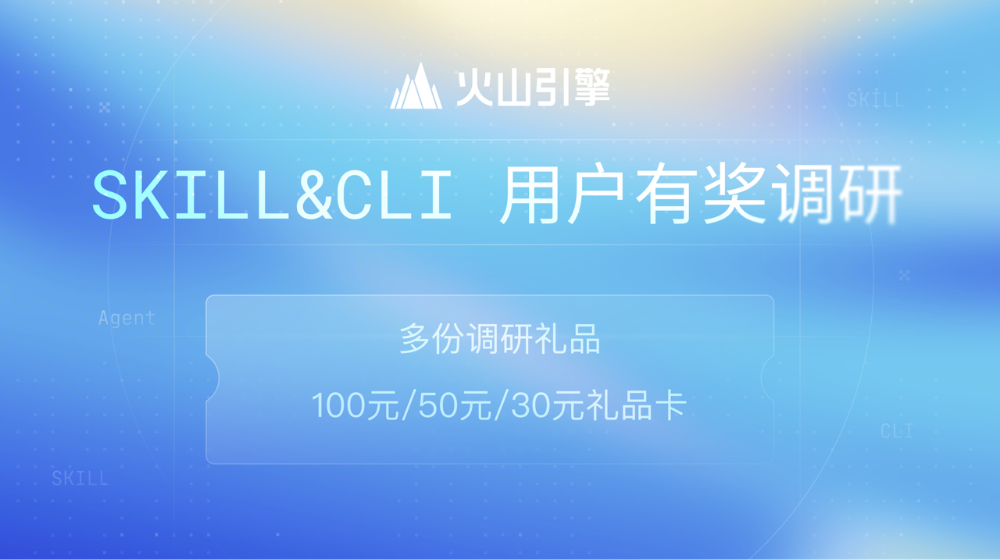

# Volcengine Cloud Control Provider

---
[](https://www.volcengine.com/survey/q/v2/7662656599489085475/q36U8r81/5ffc/channel=doc)

To improve your experience with Volcengine skill, we invite you to participate in our [Survey with Prizes](https://www.volcengine.com/survey/q/v2/7662656599489085475/q36U8r81/5ffc/channel=doc) .

---

The Volcengine Cloud Control Provider enables interaction with various Volcengine-supported resources through the Cloud Control API. Prior to usage, you must configure the provider with appropriate credentials.

Use the left navigation panel to explore available resource documentation. If you cannot find the desired resource, please submit an issue report for assistance.

> **NOTE**：
> 1. The Volcengine Cloud Control provider requires the use of Terraform 1.0.7 or later. 
> 2. This guide requires an available Volcengine account or sub-account to create resources.

## Network Mirror Configuration

If you experience slow provider downloads, you can configure a network mirror to accelerate the process. Add the following configuration to your Terraform CLI configuration file:

### Linux & macOS

Create or edit the `~/.terraformrc` file:

```hcl
provider_installation {
  network_mirror {
    url     = "https://mirrors.volces.com/terraform/terraformcc/"
    include = ["registry.terraform.io/volcengine/volcenginecc"]
  }
  direct {
    exclude = ["registry.terraform.io/volcengine/volcenginecc"]
  }
}
```

### Windows

Create or edit the `%APPDATA%\terraform.rc` file:

```hcl
provider_installation {
  network_mirror {
    url     = "https://mirrors.volces.com/terraform/terraformcc/"
    include = ["registry.terraform.io/volcengine/volcenginecc"]
  }
  direct {
    exclude = ["registry.terraform.io/volcengine/volcenginecc"]
  }
}
```

> **NOTE**: The `direct` block with `exclude` ensures that only the volcenginecc provider is fetched from the mirror, while other providers continue to be downloaded directly from the Terraform registry.

## Example Usage

Terraform 1.0.7 and later:

```shell
# Configure the Volcenginecc Provider
terraform {
  required_providers {
    volcenginecc = {
      source  = "volcengine/volcenginecc"
      version = "~> 0.0.1"
    }
  }
}

# Create VPC
resource "volcenginecc_vpc_vpc" "VPCDemo" {
  vpc_name = "vpc-demo"
  description = "VpcDemo Example"
  cidr_block = "192.168.0.0/24"
  support_ipv_4_gateway = true
  enable_ipv_6 = false
  project_name = "default"
  tags = [
    {
      key = "env"
      value = "test"
    }
  ]
}

# Query VPC
data "volcenginecc_vpc_vpc" "VpcVpcDataSource" {
  id = volcenginecc_vpc_vpc.VPCDemo.id
}
```

## Authentication

The Volcenginecc provider first resolves source credentials and then optionally uses those credentials to call STS AssumeRole.

### Static credentials

Static credentials can be provided by adding an public_key and private_key in-line in the volcengine provider block:

> **Warning**:
> Hard-coded credentials are not recommended in any Terraform configuration and risks secret leakage should this file ever be committed to a public version control system.

**Authentication Resolution and Requirements:**

- **Explicit Profile Authentication**: An explicitly configured `profile` selects that Profile even if AK/SK environment variables are present.
- **Explicit AK/SK Authentication**: `access_key`, `secret_key`, and optional `session_token` select static source credentials.
- **Default Credential Provider**: When neither Profile nor AK/SK is explicitly configured, the SDK default credential chain is used.
- **AssumeRole**: When `assume_role` is configured, it wraps an explicitly resolvable Profile or AK/SK source and supplies the final target-role credentials.
- **Validation Rules**:
    - Do not configure Profile and AK/SK together explicitly; ambiguous explicit sources return an error
    - The `file_path` parameter is optional. If not specified, the default file `~/.volcengine/config.json` is used
    - A `ramrolearn` Profile cannot be combined with Provider-level `assume_role` in V1
    - The opaque DefaultCredentialProvider chain cannot be combined with `assume_role` in V1; configure Profile or AK/SK explicitly or through their dedicated environment variables

Usage:

```terraform
provider "volcenginecc" {
  region    = "cn-beijing"
  profile   = "platform-admin"
  file_path = "/path/to/.volcengine/config.json"

  assume_role {
    assume_role_trn = "trn:iam::222222222222:role/terraform-execution"
    duration_seconds = 3600
  }
}
```

### Environment variables

Set `VOLCENGINE_REGION` and choose either AK/SK or Profile credentials. If both sources are configured, AK/SK takes precedence and the provider returns a warning:

```shell
provider "volcenginecc" {

}
```

Usage:

```shell
$ export VOLCENGINE_REGION="cn-beijing"

# Option 1: AK/SK credentials
$ export VOLCENGINE_ACCESS_KEY="your_public_key"
$ export VOLCENGINE_SECRET_KEY="your_private_key"
$ export VOLCENGINE_SESSION_TOKEN="your_session_token" # optional, used for STS temporary credentials

# Option 2: Profile credentials (do not set AK/SK at the same time)
# export VOLCENGINE_PROFILE="your_profile"
# export VOLCENGINE_FILE_PATH="your_file_path" # defaults to ~/.volcengine/config.json
```

## Authenticated Cloud Control proxy

Use `proxy_url` together with `proxy_authorization` when Cloud Control API requests must pass through an authenticated HTTP proxy. `proxy_authorization` is the complete value of the `Proxy-Authorization` header and is marked sensitive. For HTTP proxies, keep credentials out of `proxy_url` and use this attribute instead. `proxy_authorization` supports HTTP and HTTPS proxy URLs; SOCKS5 and SOCKS5H URLs remain available without this attribute.

For a ZTI proxy, configure the same values used by curl:

```shell
PSM="<your-psm>"
PROXY="<your-proxy-domain>"
AUTH_TOKEN=$(echo -n "ZTI_$PSM:$(cat "$SEC_TOKEN_PATH")" | base64 -w0)

export VOLCENGINE_PROXY_URL="http://${PROXY}:8080"
export VOLCENGINE_PROXY_AUTHORIZATION="Basic ${AUTH_TOKEN}"
```

The equivalent Terraform configuration is:

```hcl
variable "proxy_authorization" {
  type      = string
  sensitive = true
}

provider "volcenginecc" {
  proxy_url           = "http://<your-proxy-domain>:8080"
  proxy_authorization = var.proxy_authorization
}
```

Standard `no_proxy` rules identify destinations that connect directly instead of using `proxy_url`:

```hcl
provider "volcenginecc" {
  proxy_url           = "http://<your-proxy-domain>:8080"
  proxy_authorization = var.proxy_authorization
  no_proxy            = "localhost,127.0.0.1,.internal.example.com"
}
```

To use the proxy only for specified destinations, configure the inverse allowlist with `proxy_include_domains`:

```hcl
provider "volcenginecc" {
  proxy_url           = "http://<your-proxy-domain>:8080"
  proxy_authorization = var.proxy_authorization
  proxy_include_domains = [
    "cloudcontrol.cn-beijing.volcengineapi.com",
  ]
}
```

Replace `cn-beijing` with the configured region, or list the host from `endpoints.cloudcontrolapi` when using a custom endpoint. A domain without a leading dot matches the domain and its subdomains; a leading dot matches subdomains only. IP addresses, CIDR ranges, optional ports, and `*` follow standard `NO_PROXY` matching. `no_proxy` and `proxy_include_domains` cannot be configured together.

The equivalent environment variables are `VOLCENGINE_NO_PROXY` (with `NO_PROXY` and `no_proxy` as fallbacks) and comma-separated `VOLCENGINE_PROXY_INCLUDE_DOMAINS`. Explicit provider attributes take precedence over the environment variables. These settings apply to Cloud Control API traffic; STS calls made by `assume_role` use a separate client.

<!-- schema generated by tfplugindocs -->

## Schema

### Optional

- `access_key` (String) The Access Key for Volcengine Provider. It can also be sourced from the `VOLCENGINE_ACCESS_KEY` environment variable
- `secret_key` (String) The Secret Key for Volcengine Provider. It can also be sourced from the `VOLCENGINE_SECRET_KEY` environment variable
- `session_token` (String) The Session Token for Volcengine Provider. It can also be sourced from the `VOLCENGINE_SESSION_TOKEN` environment variable
- `profile` (String) The Profile for Volcengine Provider. It can be sourced from the `VOLCENGINE_PROFILE` environment variable. Complete AccessKey and SecretKey credentials take precedence when both sources are configured
- `file_path` (String) The File Path for Volcengine Provider. It specifies the path to the profile configuration file. If not specified, the default file `~/.volcengine/config.json` will be used, and can also be sourced from the `VOLCENGINE_FILE_PATH` environment variable
- `assume_role` (Attributes) An `assume_role` block that uses the selected source credentials to obtain target-role credentials. Only one `assume_role` block may be in the configuration. (see [below for nested schema](#nestedatt--assume_role))
- `customer_headers` (String) CUSTOMER HEADERS for Volcengine Provider. The customer_headers field uses commas (,) to separate multiple headers, and colons (:) to separate each header key from its corresponding value.
- `disable_ssl` (Boolean) Disable SSL for Volcengine Provider
- `endpoints` (Attributes) An `endpoints` block (documented below). Only one `endpoints` block may be in the configuration. (see [below for nested schema](#nestedatt--endpoints))
- `no_proxy` (String) Comma-separated hosts, domain suffixes, IP addresses, or CIDR ranges that bypass proxy_url. It follows standard NO_PROXY matching and can be sourced from VOLCENGINE_NO_PROXY, NO_PROXY, or no_proxy.
- `proxy_authorization` (String, Sensitive) Value of the Proxy-Authorization header for Cloud Control API proxy requests, for example `Basic <token>`. It can also be sourced from the `VOLCENGINE_PROXY_AUTHORIZATION` environment variable.
- `proxy_include_domains` (Set of String) Hosts, domain suffixes, IP addresses, or CIDR ranges that use proxy_url while all other destinations connect directly. It can be sourced as a comma-separated list from VOLCENGINE_PROXY_INCLUDE_DOMAINS and cannot be combined with no_proxy.
- `proxy_url` (String) HTTP, HTTPS, SOCKS5, or SOCKS5H proxy URL for Cloud Control API requests. It can also be sourced from the `VOLCENGINE_PROXY_URL` environment variable.
- `region` (String) The Region for Volcengine Provider. It must be provided, but it can also be sourced from the `VOLCENGINE_REGION` environment variable


<a id="nestedatt--assume_role"></a>

### Nested Schema for `assume_role`

Required:

- `assume_role_trn` (String) he TRN of the role to assume.

Optional:

- `duration_seconds` (Number) The duration of the session when making the AssumeRole call. Its value ranges from 900 to 43200(seconds), and default is 3600 seconds.
- `policy` (String) A more restrictive policy when making the AssumeRole call

<a id="nestedatt--endpoints"></a>

### Nested Schema for `endpoints`

Optional:

- `cloudcontrolapi` (String) Use this to override the default Cloud Control API service endpoint URL
- `sts` (String) Use this to override the default STS service endpoint URL

## Security and privacy

This project takes security seriously.
For vulnerability reporting and supported versions, see [SECURITY.md](SECURITY.md)
